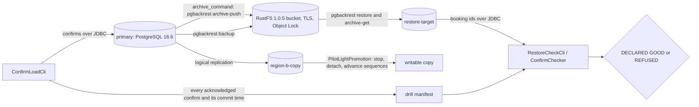

# Architecture of seatwave-recovery

Module 40 of System Design Fundamentals: SeatWave's disaster recovery. Two halves share one rule.

## Packages

| Package | What it holds | Needs |
|---|---|---|
| `archive` | `LogRecord` (one logged change), `SegmentArchive` (segments that close when full or after the archive timeout, CRC32C-framed, read back with every frame checked) | the JDK |
| `backup` | `BaseBackup` (a copy of the data files with a SHA-256 manifest; a restore that checks every file while it copies), `BackupHealth` (Section 10's backup age, counting verified backups only) | the JDK |
| `restore` | `PointInTimeRestore` (files, then replay in LSN order to an exclusive target, stop at a gap), `RestoreOutcome`, `RestoreChecker` (the drill store's checker), `ConfirmManifest` and `ConfirmChecker` (the real lab's manifest and checker) | the JDK, result4j |
| `objectives`, `drill`, `chaos`, `runbook` | the models: RPO and RTO per tier, the restore size model, the chaos experiment, the plan check | the JDK |
| `labs` | the three lab solutions | the packages above |
| `stack` | the programs that need the lab: the load generator, the JDBC checker, the pilot light, the archive sampler, the settings, the pgBackRest output readers | PostgreSQL JDBC, HikariCP, Jackson |
| (root) | `PitrDrillCli`, the four restores on files | the packages above |

The dependency rule: `stack` may use every other package; nothing else uses `stack`. The models and
the drill store run without Docker, so `./gradlew check` needs only a JDK. Coverage is counted on
everything but `stack`, which the stack tests exercise.

## The data flow of a drill on the lab

## Walk-throughs

**A point-in-time restore.** `scripts/restore-drill.sh <manifest> --before T` removes and recreates
the restore target, runs `pgbackrest restore --type=time --target=T --target-exclusive
--target-action=promote` into its empty volume, starts it, waits until PostgreSQL has replayed the
archive and promoted, then runs `RestoreCheckCli`, which reads the target's booking ids for the
manifest's event and asks `ConfirmChecker` whether every confirm acknowledged before T is present
and none at or after it. Each step's start and length go to the drill log.

**A replay that stops short.** With `--end`, the restore replays whatever the archive holds and
promotes. If a segment in the middle is missing or damaged, PostgreSQL stops there and opens as if
the archive had ended: the database looks healthy. `ConfirmChecker` refuses it, because the manifest
says the archive was complete (the drill switched and archived the last segment before it began),
and reports that the missing confirms form a tail. With `--before`, PostgreSQL itself refuses to
open a copy that cannot reach its target; the drill script reports the stop.

**The pilot light.** `PilotLightCli subscribe` publishes the four bookings tables on the primary and
subscribes the copy. `promote` disables the subscription, detaches it from the primary's slot, drops
it, and advances each identity sequence of the schema past the copy's highest id plus a margin
(`promotion.sequenceMargin`), because logical replication carries rows and not sequence values.

## Decisions and trade-offs

- **pgBackRest from the distribution package, not built from source.** The PostgreSQL project's
  Debian repository has the current release, 2.60.0, which the official image already trusts; a
  pinned package is smaller to explain and to keep current than a build. See
  `docs/backup-tool-and-store.md`.
- **RustFS with TLS and a lab authority.** pgBackRest reaches an S3 store over TLS only, and the
  certificate is checked rather than skipped, so the lab runs the configuration production would.
- **Object Lock on the lab bucket.** The rule Section 10 gives production (no key deletes a backup
  early) is set on the lab too, and tested: a locked version cannot be deleted. The tests that hide
  a segment add a delete marker, which leaves the version recoverable, and remove the marker after.
- **The manifest comes from the load generator, the checker reads the database.** A manifest written
  from the backup would agree with any restore of it; the load generator's record of acknowledged
  commits is independent, which is what lets the checker refuse a short replay.
- **Commit timestamps from PostgreSQL.** The load generator reads `pg_xact_commit_timestamp` for each
  acknowledged confirm (`track_commit_timestamp=on`), the clock a recovery target is compared with,
  so the checker's "before the target" is exact, not a guess from the client's clock.
- **verify's text, not its exit status.** pgBackRest 2.60.0's `verify` exited 0 on this lab when it
  found a damaged file; `PgBackRestInfo.verified` reads the status it printed for each backup.
- **One machine, no regions.** Every service shares Docker's virtual machine. The lab proves
  mechanisms (archiving, restore, replay, promotion, a checker that refuses); its rates and lags are
  this laptop's and never a region's.

## Invariants and where they are enforced

| Invariant | Enforced in | Tested by |
|---|---|---|
| A restore of the drill store is declared good only if it matches its manifest | `RestoreChecker.declare`; `Declared` has a private constructor | `RecoveryInvariantTest` |
| A backup whose files do not match their manifest is refused and leaves nothing behind | `BaseBackup.restoreFiles` | `RecoveryInvariantTest` |
| A restore of the lab is declared good only if every confirm acknowledged before the target is present, none after, and no unknown row | `ConfirmChecker.check` | `ConfirmCheckerTest`, `RestoreDrillOnPostgresTest` |
| A backup counts as a success only once verified | `BackupHealth.newestGood` | `BackupHealthTest`, `BackupVerificationOnPostgresTest` |
| No experiment exists without an abort condition | `ChaosExperimentCli.Experiment`'s constructor | `RecoveryInvariantTest` |
| A plan step never waits for a later or a missing step | `RunbookCheckCli.check` | `RunbookCheckCliTest` |
| A promoted copy's sequences are past every id it holds | `PilotLightPromotion.promote` | `PilotLightOnPostgresTest` |
| No backup is deleted before its retention ends | the bucket's Object Lock rule (`scripts/stack.sh`) | `docs/backup-tool-and-store.md` |
